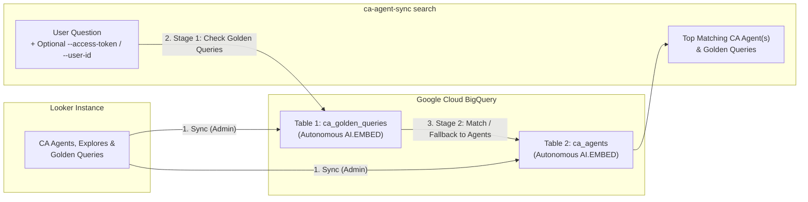

# Looker CA Agent Search (`ca-agent-sync`)

**Find the right Looker Conversational Analytics (CA) agent for any natural-language question—automatically and securely.**

As organizations build dozens of Looker Conversational Analytics agents across different departments (Sales, Finance, Engineering, Support), users and orchestrator apps quickly run into an **agent routing problem**: *Which agent should I ask to answer this question?*

`ca-agent-sync` solves this out of the box. It syncs your Looker CA agents and their curated Golden Queries into Google Cloud BigQuery, automatically generates vector embeddings using [BigQuery Autonomous Embedding Generation](https://cloud.google.com/bigquery/docs/autonomous-embedding-generation) (`AI.EMBED`), and lets you semantically route any question to the best agent—while respecting each user's Looker permissions (`--access-token` or `--user-id`).

---

## How It Works



1. **Sync (Admin):** Pulls CA agent profiles, LookML Explore descriptions, and curated Golden Queries from Looker into two BigQuery tables (`ca_agents` and `ca_golden_queries`), where BigQuery automatically generates and maintains `text-embedding-005` vector embeddings in the background.
2. **Two-Step Smart Routing:** When a question arrives, Stage 1 checks if it matches a curated **Golden Query** above your confidence threshold. If it matches, Stage 2 narrows the search to those candidate agents; if not, Stage 2 automatically falls back to searching full **Agent** descriptions, explores, and instructions.
3. **User-Scoped Multi-Tenancy:** Pass a user's Looker `--access-token` or `--user-id` at search time to pre-filter BigQuery vector search so it only returns agents that specific user is allowed to access.

---

## Prerequisites

- **Python 3.11+** and **[`uv`](https://docs.astral.sh/uv/)**
- **Looker Instance** (Looker Core or self-hosted) with Conversational Analytics enabled and API credentials (`LOOKERSDK_BASE_URL`, `LOOKERSDK_CLIENT_ID`, `LOOKERSDK_CLIENT_SECRET`)
- **Google Cloud Project** with the **BigQuery**, **BigQuery Connection**, and **Vertex AI** APIs enabled, plus local Application Default Credentials:
  ```bash
  gcloud auth application-default login
  ```

---

## Quickstart (4 Steps)

### Step 1: Clone & Configure `.env`

```bash
git clone https://github.com/lkrdev/looker-ca-agent-search.git
cd looker-ca-agent-search
uv sync
cp .env.example .env
```

Open `.env` and set your Looker credentials and Google Cloud project ID:

```dotenv
LOOKERSDK_BASE_URL=https://your-instance.cloud.looker.com
LOOKERSDK_CLIENT_ID=your_looker_client_id
LOOKERSDK_CLIENT_SECRET=your_looker_client_secret

CA_AGENT_SYNC_PROJECT_ID=your-gcp-project-id
```

### Step 2: Initialize BigQuery Infrastructure

Creates the BigQuery dataset (`looker_agent_registry`), Cloud Resource Connection (`ca_agent_embedding_conn`), Vertex AI IAM binding, and both autonomous embedding tables (`ca_agents` and `ca_golden_queries`):

```bash
uv run ca-agent-sync init
```

### Step 3: Sync Looker CA Agents

Fetches all active CA agents and Golden Queries from Looker and upserts them into BigQuery:

```bash
uv run ca-agent-sync sync --batch
```

*(Optional: Check background embedding progress anytime with `uv run ca-agent-sync status`.)*

### Step 4: Search for the Right Agent

**Basic Agent Search (Admin / Global Catalog):**
```bash
uv run ca-agent-sync search "What is our sprint velocity and SLA compliance rate?" --top-k 3
```

**Two-Step Smart Routing (Golden Queries $\rightarrow$ Agents):**
```bash
uv run ca-agent-sync search "What is the status and completion progress of all strategic projects?" \
  --golden-queries=5 \
  --confidence_score=0.65 \
  --top-k 3
```

**User-Scoped Search (Multi-Tenant):**
```bash
# Option A: Using a Looker user's OAuth / session Bearer token (no Admin secret required on caller)
uv run ca-agent-sync search "What is our sprint velocity?" \
  --access-token "eyJhbGciOi..." \
  --golden-queries=5

# Option B: Using Admin sudo impersonation by Looker user ID
uv run ca-agent-sync search "What is our sprint velocity?" \
  --user-id 42 \
  --golden-queries=5
```

Add `--json` to any command for structured JSON output ready for downstream agents and orchestrators.

---

## Good to Know / Multi-Tenant Notes

- **Global Embeddings, Per-User Filtering:** Embeddings are generated **once globally** in BigQuery during `sync`. Passing `--access-token` or `--user-id` resolves that user's accessible agents from Looker (`GET /api/4.0/agents/search`) and pre-filters BigQuery search (`WHERE agent_id IN UNNEST(@allowed_agent_ids)`)—including Stage 2 fallbacks—so unauthorized agents are never returned.
- **Looker Core `--user-id` vs. `--access-token`:** On **Looker (Google Cloud core)**, `--user-id` (sudo via `login_user`) is only supported for **Embed Users** using an **API-only Admin Service Account**. For regular Looker Core users authenticated via Google OAuth, pass their token via `--access-token` (or the `LOOKER_ACCESS_TOKEN` env var).
- **Partial Source Warnings (`has_inaccessible_source`):** Because a CA agent can use multiple LookML explores, an agent the user can access is still returned even if they lack access to one of its underlying explores (`has_inaccessible_source: true`), accompanied by a clear warning: `"User lacks access to one or more LookML sources on this agent; some queries may fail."`
- **Viewer Access:** Users with viewer access to an agent can see its matched Golden Queries and agent metadata in search results.
- **Single Instance & Direct BigQuery Queries:** Each BigQuery dataset targets a single Looker instance, and the underlying BigQuery tables store the global catalog without Row-Level Security (RLS). If you query BigQuery directly via SQL outside the CLI, apply `WHERE agent_id IN UNNEST(@allowed_agent_ids)` to enforce user permissions.

---

## Documentation & Reference

| Document | What's Inside |
| :--- | :--- |
| **[`COMMANDS.md`](COMMANDS.md)** | Complete CLI flag reference (`init`, `sync`, `status`, `search`), JSON output schemas, BigQuery table DDLs, direct SQL recipes, and IAM setup / troubleshooting. |
| **[`.env.example`](.env.example)** | Sample environment variable template for Looker SDK credentials and BigQuery settings. |
