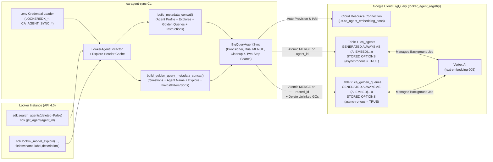

# Looker CA Agent Metadata Sync (`ca-agent-sync`)

> **Full CLI Command & Flag Reference**: See [**`COMMANDS.md`**](COMMANDS.md) for every command (`init`, `sync`, `status`, `search`), all flags, copy-pasteable single-step & two-step routing examples, and sample JSON outputs.

`ca-agent-sync` is a Python CLI service that pulls **Looker Conversational Analytics (CA) agent** and **Golden Query** metadata via the Looker 4.0 API and synchronizes them into two Google Cloud BigQuery tables (`ca_agents` and `ca_golden_queries`) configured with **[BigQuery Autonomous Embedding Generation](https://docs.cloud.google.com/bigquery/docs/autonomous-embedding-generation)** (`GENERATED ALWAYS AS (AI.EMBED(...)) STORED OPTIONS (asynchronous = TRUE)`).

By maintaining autonomous vector embeddings for both **curated Golden Queries** (`ca_golden_queries`) and **full Agent profiles** (`ca_agents`), `ca-agent-sync` enables a **Two-Step Semantic Routing Architecture** with optional **Multi-Tenant / User-Scoped Authorization (`--user-id` or `--access-token`)**:
1. **Optional User-Scoped Allowlist Resolution (`--user-id` / `--access-token`)**: When searching on behalf of a specific Looker user, `ca-agent-sync search` resolves the exact list of CA agents that user can access (`GET /api/4.0/agents/search`)—either by impersonating the user via Admin sudo (`--user-id` / `-u`) or passing the user's OAuth/session Bearer token directly (`--access-token` / `LOOKER_ACCESS_TOKEN`)—and pre-filters all BigQuery vector searches (`WHERE agent_id IN UNNEST(@allowed_agent_ids)`).
2. **Stage 1 (Golden Query Vector Search on `ca_golden_queries`)**: Compares an incoming user question against curated Golden Query embeddings (`--golden-queries=<N>`, pre-filtered to `@allowed_agent_ids` when user-scoped) and checks whether any matches meet or exceed `--confidence_score` (default `0.60`).
3. **Stage 2 (Candidate-Filtered Agent Vector Search on `ca_agents`)**:
   - **High-Confidence Golden Query Match ($\ge 1$ matches $\ge$ `confidence_score`)**: Returns the matched Golden Queries and (unless `--stop-on-golden-match` is passed) runs a Stage 2 Agent vector search on `ca_agents` **filtered strictly to the distinct `agent_id`s from those matched Golden Queries** (intersected with `@allowed_agent_ids` when user-scoped).
   - **No Golden Query Match ($0$ matches $\ge$ `confidence_score`)**: Automatically falls back to a Stage 2 Agent vector search across `ca_agents` (restricted to `@allowed_agent_ids` when user-scoped, or across all active agents in Admin mode).

---

## Table of Contents

1. [Service Overview & Two-Step Routing Architecture](#1-service-overview--two-step-routing-architecture)
2. [Multi-Tenant & User-Scoped Search Architecture (Important Callouts)](#2-multi-tenant--user-scoped-search-architecture-important-callouts)
3. [Prerequisites & Required IAM Permissions](#3-prerequisites--required-iam-permissions)
4. [Quickstart & Setup Instructions](#4-quickstart--setup-instructions)
5. [CLI Command Reference (`COMMANDS.md`)](#5-cli-command-reference-commandsmd)
6. [BigQuery Dual-Table Schemas & Autonomous Embeddings](#6-bigquery-dual-table-schemas--autonomous-embeddings)
7. [Querying BigQuery for Single-Step & Two-Step Agent Routing (SQL Examples)](#7-querying-bigquery-for-single-step--two-step-agent-routing-sql-examples)
8. [Development & Testing](#8-development--testing)

---

## 1. Service Overview & Two-Step Routing Architecture

### A. Dual-Table Synchronization Pipeline (`init` & `sync`)



### B. Two-Step Semantic Routing Flow (`search --golden-queries` & Optional User-Scoped Pre-Filtering)

```mermaid
flowchart TD
    Q["User Question<br/>ca-agent-sync search '&lt;question&gt;' [--user-id &lt;ID&gt; | --access-token &lt;TOKEN&gt;]<br/>--golden-queries=5 --confidence_score=0.65 --top-k 3"]
    AUTH{"--user-id or --access-token<br/>provided?"}
    ALLOW["Resolve User Allowlist from Looker<br/>(POST /api/4.0/login/{user_id} or Bearer &lt;TOKEN&gt;)<br/>GET /api/4.0/agents/search → @allowed_agent_ids + has_inaccessible_source"]
    S1["Stage 1: Vector Search on ca_golden_queries<br/>(Pre-filtered to @allowed_agent_ids when user-scoped)<br/>Pull top --golden-queries=5 Golden Query matches"]
    GATE{"Any Golden Query match with<br/>similarity_score &gt;= confidence_score?"}
    STOP{"--stop-on-golden-match<br/>enabled?"}
    EARLY["Return matched Golden Queries immediately<br/>(Stage 2 skipped, results=[])"]
    S2_FILT["Stage 2 (Candidate-Filtered): Vector Search on ca_agents<br/>WHERE agent_id IN UNNEST(@matched_agent_ids)<br/>(Intersected with @allowed_agent_ids when user-scoped)"]
    S2_UNFILT["Stage 2 (Fallback): Vector Search on ca_agents<br/>(Filtered to @allowed_agent_ids when user-scoped,<br/>or across all active agents in Admin mode)"]

    Q --> AUTH
    AUTH -->|Yes| ALLOW
    ALLOW --> S1
    AUTH -->|No (Admin mode)| S1
    S1 --> GATE
    GATE -->|Yes (&gt;= 1 match)| STOP
    STOP -->|Yes| EARLY
    STOP -->|No| S2_FILT
    GATE -->|No (0 matches)| S2_UNFILT
```

### How It Works

1. **Read-Only Looker Extraction ([`looker_extractor.py`](src/ca_agent_sync/looker_extractor.py))**:
   - Loads `LOOKERSDK_BASE_URL`, `LOOKERSDK_CLIENT_ID`, and `LOOKERSDK_CLIENT_SECRET` from `.env` into `os.environ` and initializes the Looker 4.0 SDK (`looker_sdk.init40()`).
   - Pulls active CA agents (`sdk.search_agents(deleted=False)`) in batch mode or a specific agent (`sdk.get_agent(agent_id)`) in single-agent mode.
   - **Production-Safe Explore Header Enrichment**: In enterprise Looker environments, a single Explore can contain 1,000–3,000+ fields. Instead of pulling raw dimensions and measures (which would bloat API responses and dilute the 2,048-token window of `text-embedding-005`), `ca-agent-sync` passes `fields="name,label,description"` to `sdk.lookml_model_explore(model, explore)` and caches each unique `(model, explore)` pair in memory.
2. **Deterministic `metadata_concat` Construction for Both Tables ([`models.py`](src/ca_agent_sync/models.py))**:
   - **Agent `metadata_concat` (`build_metadata_concat` → `ca_agents`)**: Combines Agent Name, Description, Category, referenced LookML Explores (`model.explore`, `label`, `description`), Golden Queries (`questions`, `model.explore`, `fields`, `filters`), and System Instructions (`context.instructions`).
   - **Golden Query `metadata_concat` (`build_golden_query_metadata_concat` → `ca_golden_queries`)**: Extracts each active Golden Query into a `GoldenQueryRecord` keyed by `record_id = "{agent_id}:{golden_query_id}"` and combines its natural language `questions` (`list[str]`) with structured query context (`Agent Name`, `LookML Explore: model.explore`, `Fields`, `Filters`, `Sorts`).
3. **Dual Autonomous Embedding Tables, Atomic `MERGE` & Unlinked Cleanup ([`bigquery_sync.py`](src/ca_agent_sync/bigquery_sync.py))**:
   - Both `ca_agents` and `ca_golden_queries` define an `embedding` column using `GENERATED ALWAYS AS (AI.EMBED(metadata_concat, connection_id => '...', endpoint => 'text-embedding-005')) STORED OPTIONS (asynchronous = TRUE)`.
   - During `sync --batch` and `sync --agent-id <ID>`, `ca-agent-sync` executes parameterized atomic `MERGE` statements into `ca_agents` (keyed on `agent_id`) and `ca_golden_queries` (keyed on `record_id`). Both `MERGE` statements omit `embedding` from `INSERT`/`UPDATE` lists and only overwrite `metadata_concat` when `IFNULL(T.metadata_concat, '') != IFNULL(S.metadata_concat, '')`, preserving already-populated autonomous embeddings for unchanged records.
   - Any Golden Query rows in `ca_golden_queries` for the synced `agent_id`(s) that were unlinked or removed in Looker are automatically deleted (`WHERE agent_id IN UNNEST(@synced_agent_ids) AND record_id NOT IN UNNEST(@active_record_ids)`), and deleting or pruning an agent removes its rows from both tables.
4. **Two-Step Candidate-Filtered & User-Scoped Vector Search ([`bigquery_sync.py`](src/ca_agent_sync/bigquery_sync.py) & [`cli.py`](src/ca_agent_sync/cli.py))**:
   - When `--user-id <LOOKER_USER_ID>` (`-u`) or `--access-token <TOKEN>` (`LOOKER_ACCESS_TOKEN`) is passed to `ca-agent-sync search`, the CLI first queries Looker (`GET /api/4.0/agents/search?deleted=false&fields=id,deleted,has_inaccessible_source`) as that user to obtain their authorized `allowed_agent_ids` allowlist and any agents flagged with `has_inaccessible_source=true`. If the user has access to 0 agents, search short-circuits immediately without querying BigQuery.
   - When `--golden-queries=<N>` is passed to `ca-agent-sync search`, Stage 1 searches `ca_golden_queries` (`AI.SEARCH` with automatic `AI.EMBED` + `ML.DISTANCE(..., 'COSINE')` fallback if background generation is pending, pre-filtered to `@allowed_agent_ids` when user-scoped) and compares `similarity_score` against `--confidence_score` (default `0.60`).
   - If $\ge 1$ Golden Queries meet `confidence_score`, `ca-agent-sync` returns those matched Golden Queries and (unless `--stop-on-golden-match` is passed) filters Stage 2 `ca_agents` search strictly to `WHERE agent_id IN UNNEST(@matched_agent_ids)` (intersected with `@allowed_agent_ids` when user-scoped). If $0$ Golden Queries meet `confidence_score`, Stage 2 searches `ca_agents` filtered to `@allowed_agent_ids` when user-scoped (or across all rows in `ca_agents` in Admin mode).

---

## 2. Multi-Tenant & User-Scoped Search Architecture (Important Callouts)

Not all Looker users have access to the same Conversational Analytics (CA) agents. However, generating separate BigQuery vector embeddings per user does not scale. `ca-agent-sync` solves multi-tenant authorization using **Global Autonomous Embeddings + Runtime User-Scoped Pre-Filtering**:

### A. User-Scoped Search Options (`--user-id` vs. `--access-token`)

`ca-agent-sync search` supports two mutually exclusive flags to scope vector search strictly to the CA agents a target Looker user can access:

| Option / Env Var | Auth Mechanism | How It Works |
| :--- | :--- | :--- |
| **`--user-id <LOOKER_USER_ID>`**, **`-u <LOOKER_USER_ID>`** | **Admin Sudo Impersonation** (`authz_mode: "user_id"`) | Uses the Admin API3 credentials in `.env` (`LOOKERSDK_CLIENT_ID` / `LOOKERSDK_CLIENT_SECRET`) to impersonate the target user via `POST /api/4.0/login/{user_id}` (`sdk.auth.login_user(user_id)`), calls `GET /api/4.0/agents/search` to fetch only the CA agents that user can access, guarantees `sdk.auth.logout()` of the sudo session in a `finally` block, and pre-filters BigQuery vector search (`Stage 1` Golden Queries and `Stage 2` Agents) to that user's allowlist. |
| **`--access-token <TOKEN>`** *(or env var `LOOKER_ACCESS_TOKEN`)* | **Direct User Bearer Token** (`authz_mode: "access_token"`) | Passes the target user's Looker OAuth or session access token directly to `GET /api/4.0/agents/search` (`Authorization: Bearer <TOKEN>`) **without requiring Admin client credentials (`LOOKERSDK_CLIENT_ID` / `LOOKERSDK_CLIENT_SECRET`) on the search caller** (only `LOOKERSDK_BASE_URL` is required), then pre-filters BigQuery vector search to those accessible agents. |
| *(Neither flag passed)* | **Unscoped Admin Catalog** (`authz_mode: "admin"`) | Searches across all active CA agents and Golden Queries synced in BigQuery without calling Looker at search time. |

### B. Architectural Callouts & Operational Nuances

> [!IMPORTANT]
> Review these architectural boundaries when deploying `ca-agent-sync` in multi-tenant Looker environments:

1. **Global Embeddings, Runtime Pre-Filtering:**
   Embeddings in `ca_agents` and `ca_golden_queries` are generated **once globally** by the Admin `sync` workflow (`ca-agent-sync sync --batch` or `--agent-id`). Per-user authorization is enforced at search time by fetching the user's accessible `agent_id` allowlist from Looker (`GET /api/4.0/agents/search`) and pre-filtering BigQuery `AI.SEARCH` (via `(SELECT * FROM ... WHERE agent_id IN UNNEST(@allowed_agent_ids))`) and the `ML.DISTANCE` fallback (`WHERE t.agent_id IN UNNEST(@allowed_agent_ids)`). Even when Stage 1 (`ca_golden_queries`) returns 0 matches above `--confidence_score`, the Stage 2 fallback search on `ca_agents` remains strictly filtered to `@allowed_agent_ids` and never leaks unauthorized agents.
2. **Looker Core Sudo vs. Access Token Nuance:**
   On **Looker (Google Cloud core)**, `login_user` (`--user-id` sudo) is **only permitted when the Admin credentials belong to an API-only Service Account and the target user is an Embed User**. Attempting to sudo as a regular Looker Core user authenticated via Google OAuth will be rejected by Looker Core's API. For regular Looker Core (Google OAuth) users—or whenever your application already holds the user's session/OAuth token—pass their token via `--access-token <TOKEN>` or the `LOOKER_ACCESS_TOKEN` environment variable.
3. **Partial Source Access Warning (`has_inaccessible_source`):**
   In Looker, a single CA agent can be configured with multiple LookML Explores/sources. If a user has access to a CA agent in Looker, `ca-agent-sync search` **includes** that agent in search results even if Looker reports `has_inaccessible_source=true` on the agent (because the user may still have full access to other LookML Explores/sources attached to that agent). When `has_inaccessible_source=true`, both the human CLI table and `--json` output surface an explicit warning on matching Agent and Golden Query hits:
   - `has_inaccessible_source`: `true`
   - `warning`: `"User lacks access to one or more LookML sources on this agent; some queries may fail."`
4. **Viewer Disclosure Policy (Full Golden Query & Agent Metadata):**
   Viewer users who have access to a CA agent in Looker (`can.show` / `can.chat`, returned by `GET /api/4.0/agents/search`) can see the full Golden Query details (`questions`, `model`, `explore`, `fields`, `filters`, `sorts`) and agent metadata in `ca-agent-sync search` results without field redaction.
5. **Single Looker Instance Scope:**
   The BigQuery registry tables (`ca_agents` and `ca_golden_queries`) are designed for a **single Looker instance** per dataset/table pair (keyed on `agent_id` and `record_id = "{agent_id}:{golden_query_id}"`). If you manage multiple Looker instances (e.g., dev, staging, prod), configure a separate BigQuery dataset or table name per instance via `CA_AGENT_SYNC_DATASET` / `--dataset` or `CA_AGENT_SYNC_TABLE` / `--table`.
6. **Direct BigQuery SQL Consumers:**
   The underlying BigQuery tables (`ca_agents` and `ca_golden_queries`) store the global Admin-synced agent catalog **without BigQuery Row-Level Security (RLS)**. Any downstream applications, orchestrators, or analysts querying BigQuery directly via SQL (outside `ca-agent-sync search`) will see all synced agents unless they apply their own Looker allowlist filter (`WHERE agent_id IN UNNEST(@allowed_agent_ids)`). See [Section 7](#7-querying-bigquery-for-single-step--two-step-agent-routing-sql-examples) for copy-pasteable pre-filtered SQL patterns.

---

## 3. Prerequisites & Required IAM Permissions

### A. Required Google Cloud APIs

Ensure the following APIs are enabled on your target Google Cloud project:

```bash
gcloud services enable \
  bigquery.googleapis.com \
  bigqueryconnection.googleapis.com \
  aiplatform.googleapis.com \
  cloudresourcemanager.googleapis.com \
  --project=<YOUR_GCP_PROJECT_ID>
```

### B. Required IAM Roles

There are **two identities** involved in BigQuery Autonomous Embedding Generation:

#### 1. The Sync Runner (User or Service Account running `ca-agent-sync`)
The identity authenticated via Application Default Credentials (`gcloud auth application-default login`) needs:

| IAM Role | Purpose |
| :--- | :--- |
| **`roles/bigquery.dataEditor`** | Create the `looker_agent_registry` dataset, create the `ca_agents` and `ca_golden_queries` tables, and run `MERGE` / `DELETE` statements. |
| **`roles/bigquery.jobUser`** | Submit BigQuery DDL, DML (`MERGE` / `DELETE`), and `AI.SEARCH` / `AI.EMBED` query jobs. |
| **`roles/bigquery.connectionAdmin`** | Create or inspect the BigQuery Cloud Resource Connection (`ca_agent_embedding_conn`), or `roles/bigquery.connectionUser` if using a pre-created connection. |
| **`roles/resourcemanager.projectIamAdmin`** *(Optional)* | Only required if you want `ca-agent-sync init` to automatically bind `roles/aiplatform.user` to the BigQuery connection's service account. If your user does not have `projectIamAdmin`, an administrator can grant that single binding once (see below). |

#### 2. The BigQuery Cloud Resource Connection Service Account (`bqcx-...`)
When a BigQuery Cloud Resource Connection is created, Google Cloud provisions a dedicated service account (e.g., `bqcx-<PROJECT_NUMBER>-<HASH>@gcp-sa-bigquery-condel.iam.gserviceaccount.com`). BigQuery uses this service account in the background to call Vertex AI's `text-embedding-005` model.

| IAM Role | Target Principal | Purpose |
| :--- | :--- | :--- |
| **`roles/aiplatform.user`** *(Vertex AI User)* | `serviceAccount:bqcx-...` (Connection Service Account) | Allows BigQuery's background autonomous embedding job (`ca_agents` and `ca_golden_queries`) and `AI.EMBED` / `AI.SEARCH` calls to invoke Vertex AI embedding endpoints. |

> [!TIP]
> **`ca-agent-sync init` handles this automatically!** When you run `uv run ca-agent-sync init`, the CLI creates the BigQuery Cloud Resource Connection, retrieves its `serviceAccountId`, and automatically binds `roles/aiplatform.user` on the project.
>
> If you prefer to grant it manually via `gcloud`:
> ```bash
> gcloud projects add-iam-policy-binding <YOUR_GCP_PROJECT_ID> \
>   --member="serviceAccount:<CONNECTION_SERVICE_ACCOUNT_EMAIL>" \
>   --role="roles/aiplatform.user"
> ```

### C. Required Looker Permissions

- **For `sync` (`--batch` or `--agent-id`)**: The Looker API3 credentials (`LOOKERSDK_CLIENT_ID` and `LOOKERSDK_CLIENT_SECRET`) must belong to a Looker Admin or service account with read permissions to:
  - View Conversational Analytics agents and their Golden Queries (`search_agents`, `get_agent`).
  - Inspect LookML model explores (`see_lookml` / `explore` for `lookml_model_explore`).
- **For User-Scoped `search` (`--user-id` vs. `--access-token`)**:
  - **`--user-id <LOOKER_USER_ID>`**: Requires Admin credentials with `sudo` (`login_user`) permission. On **Looker (Google Cloud core)**, `login_user` is only supported when the Admin credentials belong to an **API-only Service Account** and the target user is an **Embed User**.
  - **`--access-token <TOKEN>`** (or `LOOKER_ACCESS_TOKEN`): Requires only `LOOKERSDK_BASE_URL` and a valid user OAuth or session Bearer token; no Admin client credentials are needed on the search caller.

---

## 4. Quickstart & Setup Instructions

### Step 1: Install Dependencies with `uv`

Navigate to the project directory and synchronize the virtual environment using [`uv`](https://docs.astral.sh/uv/):

```bash
cd looker-ca-agent-search
uv sync
```

Verify the CLI is installed:

```bash
uv run ca-agent-sync --help
```

### Step 2: Configure `.env`

Copy `.env.example` to `.env` and fill in your Looker API3 credentials and target Google Cloud settings:

```bash
cp .env.example .env
```

Edit `.env`:

```dotenv
# Looker Python SDK Credentials (Required for `sync` and `search --user-id`)
LOOKERSDK_BASE_URL=https://your-instance.cloud.looker.com
LOOKERSDK_CLIENT_ID=your_looker_client_id
LOOKERSDK_CLIENT_SECRET=your_looker_client_secret
LOOKERSDK_VERIFY_SSL=true
LOOKERSDK_TIMEOUT=120

# Optional: User OAuth / Session Access Token for User-Scoped Search (`search --access-token`)
# LOOKER_ACCESS_TOKEN=eyJhbGciOi...

# Google Cloud / BigQuery Autonomous Embedding Target Defaults
CA_AGENT_SYNC_PROJECT_ID=<YOUR_GCP_PROJECT_ID>
CA_AGENT_SYNC_LOCATION=US
CA_AGENT_SYNC_DATASET=looker_agent_registry
CA_AGENT_SYNC_TABLE=ca_agents
CA_AGENT_SYNC_GOLDEN_QUERIES_TABLE=ca_golden_queries
CA_AGENT_SYNC_CONNECTION_ID=ca_agent_embedding_conn
CA_AGENT_SYNC_ENDPOINT=text-embedding-005
```

> [!NOTE]
> `.env` is excluded by `.gitignore` so credentials are never committed to version control. At startup, `ca-agent-sync` automatically loads `.env` and exports `LOOKERSDK_*` into `os.environ` before initializing the Looker SDK.

### Step 3: Authenticate with Google Cloud ADC

Ensure your local Application Default Credentials (ADC) are active:

```bash
gcloud auth application-default login
```

### Step 4: Initialize Dual-Table BigQuery Infrastructure (`init`)

Run `init` once to provision and verify the BigQuery dataset, Cloud Resource Connection, `roles/aiplatform.user` IAM binding, and **both** autonomous embedding tables (`ca_agents` and `ca_golden_queries`):

```bash
uv run ca-agent-sync init
```

*(Note: `ca-agent-sync sync` also runs this check automatically unless `--skip-init` is passed.)*

---

## 5. CLI Command Reference (`COMMANDS.md`)

> **Detailed Reference**: See [**`COMMANDS.md`**](COMMANDS.md) for the complete specification of every CLI subcommand, flag, environment variable, and sample human/`--json` output.

All subcommands accept `--project-id`, `--location`, `--dataset`, `--table`, `--golden-queries-table`, `--env-file`, and `--json`.

### A. Provision Infrastructure (`init`)

```bash
uv run ca-agent-sync init
uv run ca-agent-sync init --json
```

### B. Sync All Active Agents & Golden Queries (`sync --batch`)

Fetches all active (`deleted=False`) CA agents from Looker, enriches their sources with cached lightweight Explore headers, and atomic-`MERGE`s both `ca_agents` and `ca_golden_queries` (automatically removing any unlinked Golden Queries):

```bash
uv run ca-agent-sync sync --batch
uv run ca-agent-sync sync --batch --prune
uv run ca-agent-sync sync --batch --no-explore-headers
```

### C. Sync a Single Agent & Its Golden Queries (`sync --agent-id <ID>`)

Fetches a single CA agent by its Looker ID and atomic-`MERGE`s the agent into `ca_agents` and its active Golden Queries into `ca_golden_queries` (deleting any unlinked Golden Queries or removing the agent from both tables if marked `deleted=True` or `404` in Looker):

```bash
uv run ca-agent-sync sync --agent-id <AGENT_ID>
```

### D. Check Dual-Table Autonomous Embedding Status (`status`)

Inspects both `ca_agents` and `ca_golden_queries` and reports total rows, populated embeddings (`ARRAY_LENGTH(embedding.result) > 0`), pending background generation, and any row-level embedding errors:

```bash
uv run ca-agent-sync status
uv run ca-agent-sync status --json
```

### E. Single-Step, Two-Step & User-Scoped Semantic Question Routing (`search`)

- **Single-Step Agent Search** (queries `ca_agents` directly):
  ```bash
  uv run ca-agent-sync search "What is our sprint velocity and SLA compliance rate for engineering issues?" --top-k 3
  ```
- **Two-Step Golden Query + Agent Candidate-Filtered Search** (Stage 1 searches `ca_golden_queries`; if $\ge 1$ matches meet `--confidence_score`, Stage 2 filters `ca_agents` strictly to `WHERE agent_id IN UNNEST(@matched_agent_ids)`):
  ```bash
  uv run ca-agent-sync search "What is the status and completion progress of all strategic projects?" \
    --golden-queries=5 \
    --confidence_score=0.65 \
    --top-k 3
  ```
- **Two-Step Search with Stage 1 Early Exit (`--stop-on-golden-match`)**:
  ```bash
  uv run ca-agent-sync search "What is the status and completion progress of all strategic projects?" \
    --golden-queries=5 \
    --confidence_score=0.65 \
    --stop-on-golden-match
  ```
- **Two-Step Search with Stage 1 Miss Falling Back to Unfiltered Stage 2**:
  ```bash
  uv run ca-agent-sync search "What is our sprint velocity and SLA compliance rate for engineering issues?" \
    --golden-queries=5 \
    --confidence_score=0.99 \
    --top-k 3
  ```
- **User-Scoped Search via Admin Sudo (`--user-id` / `-u`)**:
  Impersonates a target Looker user via `POST /api/4.0/login/{user_id}`, fetches their accessible `agent_id` allowlist (`GET /api/4.0/agents/search`), and pre-filters both Stage 1 (`ca_golden_queries`) and Stage 2 (`ca_agents`) vector searches to that user's allowlist:
  ```bash
  uv run ca-agent-sync search "What is the status and completion progress of all strategic projects?" \
    --user-id 42 \
    --golden-queries=5 \
    --confidence_score=0.65 \
    --top-k 3
  ```
- **User-Scoped Search via User OAuth / Session Bearer Token (`--access-token` / `LOOKER_ACCESS_TOKEN`)**:
  Calls `GET /api/4.0/agents/search` directly with `Authorization: Bearer <TOKEN>` (without requiring `LOOKERSDK_CLIENT_ID` or `LOOKERSDK_CLIENT_SECRET` on the search caller) and pre-filters BigQuery vector search to the user's accessible agents:
  ```bash
  uv run ca-agent-sync search "What is our sprint velocity and SLA compliance rate for engineering issues?" \
    --access-token "eyJhbGciOi..." \
    --top-k 3 \
    --json
  ```
  *(Note: If any matched agent has `has_inaccessible_source=true` in Looker for that user, the agent is still returned—since the user may have access to other LookML Explores/sources on that agent—and both CLI and `--json` output include `has_inaccessible_source: true` and `warning: "User lacks access to one or more LookML sources on this agent; some queries may fail."`.)*

---

## 6. BigQuery Dual-Table Schemas & Autonomous Embeddings

### Table 1: `ca_agents` (`<YOUR_GCP_PROJECT_ID>.looker_agent_registry.ca_agents`)

Stores one row per active Looker CA agent, keyed on `agent_id`:

```sql
CREATE TABLE IF NOT EXISTS `<YOUR_GCP_PROJECT_ID>.looker_agent_registry.ca_agents` (
  agent_id STRING NOT NULL,
  instance_url STRING,
  agent_url STRING,
  name STRING,
  description STRING,
  category STRING,
  system_instructions STRING,
  sources JSON,
  golden_queries JSON,
  code_interpreter BOOL,
  created_by_name STRING,
  created_at TIMESTAMP,
  updated_at TIMESTAMP,
  synced_at TIMESTAMP,
  metadata_concat STRING,
  embedding STRUCT<result ARRAY<FLOAT64>, status STRING>
    GENERATED ALWAYS AS (
      AI.EMBED(
        metadata_concat,
        connection_id => '<YOUR_GCP_PROJECT_ID>.us.ca_agent_embedding_conn',
        endpoint => 'text-embedding-005'
      )
    )
    STORED OPTIONS (asynchronous = TRUE)
);
```

#### Example `ca_agents.metadata_concat` Format

```text
Agent Name: Engineering Intelligence Assistant
Description: AI Conversational Analytics Assistant for engineering_analytics

Explores:
- Explore: engineering_analytics.issue | Label: Issues & Sprint Delivery | Description: Issue tracking, story points, cycle velocity, and SLA compliance.
- Explore: engineering_analytics.project | Label: Strategic Projects | Description: Project roadmap and health status.

Golden Queries:
- Questions: Show engineer workload and completed story points per developer | Explore: engineering_analytics.issue | Fields: assignee.name, team.name, issue.count, issue.total_story_points, issue.completed_story_points
- Questions: What is the status and completion progress of all strategic projects? | Explore: engineering_analytics.project | Fields: project.name, team.name, lead.name, project_status.name, project.state, project_metrics_rollup.latest_health_status, project.progress

System Instructions:
You are an expert Senior Engineering Intelligence & Delivery Analyst specializing in engineering operations...
```

---

### Table 2: `ca_golden_queries` (`<YOUR_GCP_PROJECT_ID>.looker_agent_registry.ca_golden_queries`)

Stores one row per active Looker Golden Query, keyed on `record_id = "{agent_id}:{golden_query_id}"` and mapped to `agent_id`:

```sql
CREATE TABLE IF NOT EXISTS `<YOUR_GCP_PROJECT_ID>.looker_agent_registry.ca_golden_queries` (
  record_id STRING NOT NULL,
  golden_query_id STRING NOT NULL,
  agent_id STRING NOT NULL,
  agent_name STRING,
  agent_url STRING,
  instance_url STRING,
  questions ARRAY<STRING>,
  model STRING,
  explore STRING,
  fields ARRAY<STRING>,
  filters JSON,
  sorts ARRAY<STRING>,
  `limit` STRING,
  answer STRING,
  synced_at TIMESTAMP,
  metadata_concat STRING,
  embedding STRUCT<result ARRAY<FLOAT64>, status STRING>
    GENERATED ALWAYS AS (
      AI.EMBED(
        metadata_concat,
        connection_id => '<YOUR_GCP_PROJECT_ID>.us.ca_agent_embedding_conn',
        endpoint => 'text-embedding-005'
      )
    )
    STORED OPTIONS (asynchronous = TRUE)
);
```

#### Example `ca_golden_queries.metadata_concat` Format

```text
Golden Query Questions: What is the status and completion progress of all strategic projects?
Agent Name: Engineering Intelligence Assistant
LookML Explore: engineering_analytics.project
Fields: project.name, team.name, lead.name, project_status.name, project.state, project_metrics_rollup.latest_health_status, project.progress
Sorts: project.progress desc
```

---

## 7. Querying BigQuery for Single-Step & Two-Step Agent Routing (SQL Examples)

Downstream applications, orchestrator agents, or customers can query the BigQuery tables directly using either **`AI.SEARCH`** (native autonomous embedding search) or **`AI.EMBED` + `ML.DISTANCE(..., 'COSINE')`**.

> [!WARNING]
> **Multi-Tenant Pre-Filtering for Direct SQL Consumers:** Because `ca_agents` and `ca_golden_queries` store the global Admin-synced agent catalog without BigQuery Row-Level Security (RLS), any direct SQL queries running on behalf of a specific Looker user **must** pass that user's accessible `agent_id` allowlist (`@allowed_agent_ids`) into `WHERE agent_id IN UNNEST(@allowed_agent_ids)` as shown below.

*(Note: On unit-normalized `text-embedding-005` embeddings, `AI.SEARCH` returns Euclidean distance $L_2$, which converts directly to cosine distance via $d_{\text{cosine}} = L_2^2 / 2$ and cosine similarity via $1 - L_2^2 / 2$.)*

### A. Stage 1: Search Curated Golden Queries (`ca_golden_queries`)

#### Unscoped (Admin Mode)
```sql
SELECT
  base.record_id,
  base.golden_query_id,
  base.agent_id,
  base.agent_name,
  base.agent_url,
  base.questions,
  base.model,
  base.explore,
  base.fields,
  base.filters,
  base.sorts,
  (1.0 - POW(distance, 2) / 2.0) AS similarity_score,
  (POW(distance, 2) / 2.0) AS distance
FROM AI.SEARCH(
  TABLE `<YOUR_GCP_PROJECT_ID>.looker_agent_registry.ca_golden_queries`,
  'metadata_concat',
  'What is the status and completion progress of all strategic projects?',
  top_k => 5
)
WHERE (1.0 - POW(distance, 2) / 2.0) >= 0.65
ORDER BY distance ASC;
```

#### User-Scoped (Pre-Filtered inside `AI.SEARCH` with `@allowed_agent_ids`)
```sql
SELECT
  base.record_id,
  base.golden_query_id,
  base.agent_id,
  base.agent_name,
  base.agent_url,
  base.questions,
  base.model,
  base.explore,
  base.fields,
  base.filters,
  base.sorts,
  (1.0 - POW(distance, 2) / 2.0) AS similarity_score,
  (POW(distance, 2) / 2.0) AS distance
FROM AI.SEARCH(
  (SELECT * FROM `<YOUR_GCP_PROJECT_ID>.looker_agent_registry.ca_golden_queries` WHERE agent_id IN UNNEST(@allowed_agent_ids)),
  'metadata_concat',
  @query_text,
  top_k => @top_k
)
WHERE (1.0 - POW(distance, 2) / 2.0) >= @confidence_score
ORDER BY distance ASC;
```

### B. Stage 2 (Candidate-Filtered / User-Scoped): Search `ca_agents` Filtered to `@matched_agent_ids`

When Stage 1 returns $\ge 1$ Golden Queries above your confidence threshold (or when pre-filtering by a user's `@allowed_agent_ids`), pass the target `agent_id`s as `@matched_agent_ids` (`ARRAY<STRING>`) to filter `ca_agents`:

#### Option 1: Using `AI.SEARCH` Pre-Filtered with `WHERE agent_id IN UNNEST(@matched_agent_ids)`

```sql
SELECT
  base.agent_id,
  base.name,
  base.description,
  base.agent_url,
  base.sources,
  (1.0 - POW(distance, 2) / 2.0) AS similarity_score,
  (POW(distance, 2) / 2.0) AS distance
FROM AI.SEARCH(
  (SELECT * FROM `<YOUR_GCP_PROJECT_ID>.looker_agent_registry.ca_agents` WHERE agent_id IN UNNEST(@matched_agent_ids)),
  'metadata_concat',
  @query_text,
  top_k => @top_k
)
ORDER BY distance ASC
LIMIT @top_k;
```

#### Option 2: Using `AI.EMBED` + `ML.DISTANCE(..., 'COSINE')` with `WHERE agent_id IN UNNEST(@matched_agent_ids)`

Works even while background autonomous embedding generation is still warming up for newly synced rows:

```sql
WITH query_emb AS (
  SELECT AI.EMBED(
    @query_text,
    connection_id => '<YOUR_GCP_PROJECT_ID>.us.ca_agent_embedding_conn',
    endpoint => 'text-embedding-005'
  ).result AS vec
),
candidate_agents AS (
  SELECT
    t.agent_id,
    t.name,
    t.description,
    t.category,
    t.agent_url,
    t.instance_url,
    t.sources,
    CASE
      WHEN t.embedding IS NOT NULL AND ARRAY_LENGTH(t.embedding.result) > 0 THEN t.embedding.result
      ELSE AI.EMBED(
        t.metadata_concat,
        connection_id => '<YOUR_GCP_PROJECT_ID>.us.ca_agent_embedding_conn',
        endpoint => 'text-embedding-005'
      ).result
    END AS agent_vec
  FROM `<YOUR_GCP_PROJECT_ID>.looker_agent_registry.ca_agents` AS t
  WHERE agent_id IN UNNEST(@matched_agent_ids)
)
SELECT
  c.agent_id,
  c.name,
  c.description,
  c.agent_url,
  c.sources,
  ML.DISTANCE(c.agent_vec, q.vec, 'COSINE') AS distance,
  (1.0 - ML.DISTANCE(c.agent_vec, q.vec, 'COSINE')) AS similarity_score
FROM candidate_agents AS c
CROSS JOIN query_emb AS q
WHERE ARRAY_LENGTH(c.agent_vec) > 0
ORDER BY distance ASC
LIMIT @top_k;
```

### C. Single-Step / Unfiltered Stage 2 Fallback (`ca_agents`)

When running unscoped Admin single-step search or when 0 Golden Queries meet `confidence_score` in Stage 1 (in Admin mode):

```sql
SELECT
  base.agent_id,
  base.name,
  base.description,
  base.agent_url,
  base.sources,
  (1.0 - POW(distance, 2) / 2.0) AS similarity_score,
  (POW(distance, 2) / 2.0) AS distance
FROM AI.SEARCH(
  TABLE `<YOUR_GCP_PROJECT_ID>.looker_agent_registry.ca_agents`,
  'metadata_concat',
  'What is our sprint velocity and SLA compliance rate for engineering issues?',
  top_k => 3
)
ORDER BY distance ASC;
```

---

## 8. Development & Testing

Run the automated unit test suite (`pytest`) and linter (`ruff`):

```bash
uv run pytest -v
uv run ruff check src/ tests/
```
